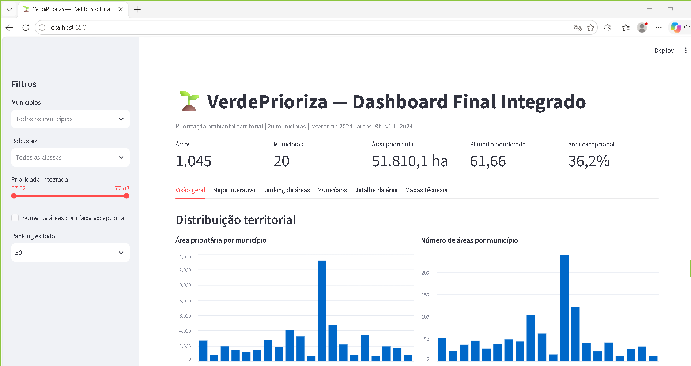

# VerdePrioriza

Sistema de apoio à decisão para **priorização territorial ambiental**, desenvolvido com dados públicos, banco de dados espacial e análise multicritério.

O projeto integra dados municipais e espaciais para identificar, comparar e explicar áreas com maior prioridade relativa para ações de restauração, proteção de recursos hídricos e planejamento ambiental.

> **Importante:** o VerdePrioriza é uma ferramenta de triagem e apoio à decisão. Seus resultados não representam, isoladamente, obrigação legal de restauração, déficit de APP ou Reserva Legal, disponibilidade fundiária ou autorização automática de intervenção.

---

## Visão geral

O VerdePrioriza foi estruturado em módulos sucessivos de ingestão, processamento, análise, priorização espacial, validação e publicação.

Na versão atual, com referência ambiental **2024**, o projeto consolidou:

- 20 municípios-alvo;
- 1.045 áreas prioritárias finais;
- 51.810,1 ha de área priorizada;
- 37.443,5 ha de núcleo;
- 14.366,5 ha de suporte espacial;
- 18.766,8 ha de faixa excepcional;
- fichas técnicas individuais;
- relatório executivo municipal;
- explicabilidade por área;
- dashboard final integrado em Streamlit.

---

## Dashboard final



O dashboard reúne:

- indicadores gerais;
- filtros por município;
- filtros por robustez;
- faixa de Prioridade Integrada;
- mapa interativo;
- ranking das áreas;
- comparação municipal;
- acesso às fichas técnicas;
- explicabilidade;
- mapas técnicos consolidados.

---

## Arquitetura resumida

```text
Dados públicos
    ↓
ETL / ingestão
    ↓
PostgreSQL + PostGIS
    ↓
Feature engineering
    ↓
IPA municipal
    ↓
IPL local
    ↓
Prioridade Integrada
    ↓
Seleção territorial 9H
    ↓
Validação espacial 9I
    ↓
10A — Fichas técnicas
10B — Relatório executivo
10C — Explicabilidade
10D — Dashboard final
```

Mais detalhes em:

- [Arquitetura](docs/ARQUITETURA.md)
- [Metodologia](docs/METODOLOGIA.md)
- [Execução](docs/EXECUCAO.md)
- [Limitações](docs/LIMITACOES.md)

---

## Principais fontes de dados

O projeto utiliza, entre outras fontes:

- MapBiomas Cobertura;
- MapBiomas Fogo;
- INPE Queimadas;
- IBGE;
- dados espaciais municipais;
- camadas derivadas de relevo, hidrologia, vegetação e conectividade.

A referência temporal consolidada desta versão é **2024**.

---

## Tecnologias

- Python
- PostgreSQL 17
- PostGIS
- pgAdmin 4
- SQLAlchemy
- psycopg
- GeoPandas
- pandas
- Matplotlib
- Streamlit
- PyDeck

---

## Estrutura principal do projeto

```text
verde_prioriza/
│
├── data/
│   └── raw/
│
├── sql/
│   ├── ...
│   ├── 18_relatorio_executivo_10b.sql
│   ├── 19_explicabilidade_modelo_10c.sql
│   └── 20_dashboard_final_10d.sql
│
├── src/
│   ├── analysis/
│   ├── ingestion/
│   ├── inspection/
│   ├── reporting/
│   ├── visualization/
│   └── dashboard/
│       └── dashboard_final_10d.py
│
├── outputs/
│   ├── maps/
│   └── reports/
│
├── docs/
│   ├── ARQUITETURA.md
│   ├── METODOLOGIA.md
│   ├── EXECUCAO.md
│   ├── LIMITACOES.md
│   └── images/
│
├── .env
├── .gitignore
└── README.md
```

Arquivos grandes de dados, saídas geradas e credenciais locais não devem ser versionados.

---

## Execução do dashboard

Com o ambiente virtual ativado:

```powershell
cd C:\verde_prioriza
streamlit run src/dashboard/dashboard_final_10d.py
```

O Streamlit abrirá o dashboard localmente.

---

## Produtos gerados

### 10A — Fichas técnicas
Uma ficha individual para cada uma das 1.045 áreas prioritárias.

### 10B — Relatório executivo
Síntese consolidada dos 20 municípios.

### 10C — Explicabilidade
Explicação individual das áreas, incluindo:

- posição no ranking;
- Prioridade Integrada;
- IPA municipal;
- IPL local;
- robustez;
- componentes ambientais;
- comparação com o conjunto das áreas;
- contexto municipal.

### 10D — Dashboard final
Interface integrada para exploração e comunicação dos resultados.

---

## Reprodutibilidade

O projeto separa:

1. dados brutos;
2. processamento;
3. banco espacial;
4. indicadores derivados;
5. produtos analíticos;
6. visualização.

Para reproduzir a execução em outra máquina, consulte [EXECUCAO.md](docs/EXECUCAO.md).

---

## Segurança

Nunca publique:

- `.env`;
- senhas;
- strings de conexão com credenciais;
- backups de banco com informações sensíveis;
- arquivos temporários locais;
- credenciais de serviços externos.

O `.gitignore` deste pacote já contempla esses itens.

---

## Estado atual

```text
Módulo 1  — Ambiente.......................... concluído
Módulo 2  — Arquitetura de banco.............. concluído
Módulo 3  — IBGE.............................. concluído
Módulo 4  — MapBiomas Cobertura............... concluído
Módulo 5  — Fogo.............................. concluído
Módulo 6  — Feature engineering............... concluído
Módulo 7  — IPA............................... concluído
Módulo 8  — Dashboard inicial................. concluído
Módulo 9  — Priorização espacial.............. concluído e validado
10A       — Fichas técnicas................... concluído
10B       — Relatório executivo............... concluído
10C       — Explicabilidade................... concluído
10D       — Dashboard final integrado......... concluído
10E       — Documentação e publicação......... em consolidação
```

---

## Autor

Projeto desenvolvido por **Leandro** como aplicação prática de análise de dados, geoprocessamento e apoio à decisão ambiental.
